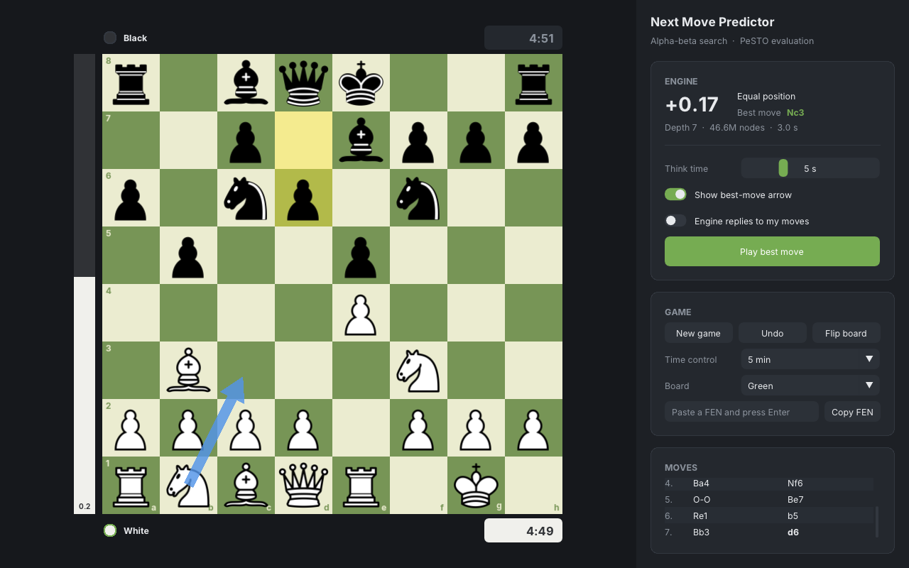
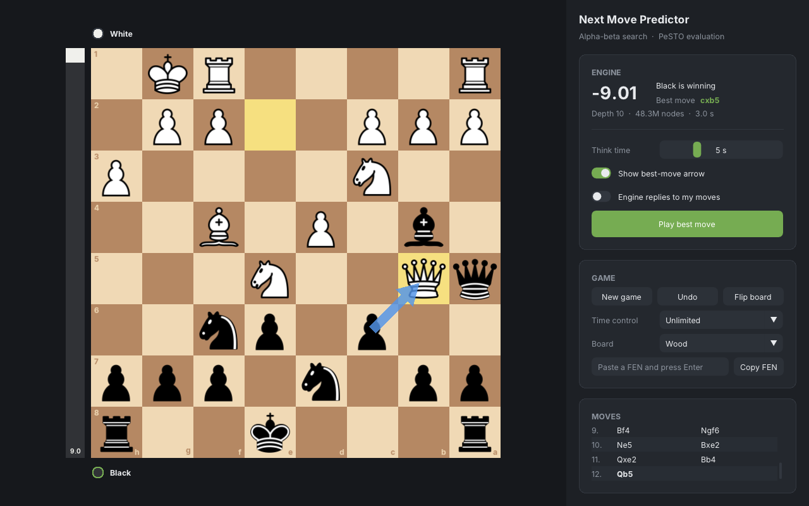

<div align="center">

# Chess Next Move Predictor

A desktop chess board with a built-in C++ engine that analyses every position and predicts the best next move.

[](https://en.cppreference.com/w/cpp/17)
[](https://github.com/SFML/SFML)
[](https://github.com/ocornut/imgui)
[](https://github.com/Disservin/chess-library)



</div>

## Features

**Board**
- Drag-and-drop or click-to-move, with legal-move dots, last-move and check highlights
- Promotion picker, castling, en passant and all draw rules (stalemate, repetition, 50 moves, insufficient material)
- Flip the board, undo moves and pick a board theme (Green, Wood, Blue, Slate)
- Optional chess clocks (1 to 30 minutes)
- Paste a FEN to analyse any position, or copy the current one

**Engine**
- Analyses every new position in the background, so the window never freezes
- Live evaluation bar, score, search depth and a best-move arrow
- **Play best move** lets the engine move for the side to play (1 to 15 s think time, or stop early with *move now*)
- Optional auto-reply, so you can play a full game against the engine

<p align="center">
  
</p>

## Building

You need a C++17 compiler and CMake 3.16+. SFML 3, Dear ImGui, ImGui-SFML and chess.hpp are git submodules.

```bash
git clone --recursive https://github.com/anurag67-droid/chess-next-move-predictor.git
cd chess-next-move-predictor
cmake -S . -B build
cmake --build build -j
./build/ChessNextMovePredictor
```

If you already cloned without `--recursive`, run `git submodule update --init` first.

If SFML 3 is installed on your system, CMake uses it. Otherwise it builds the bundled copy, which on Linux needs a few development packages:

```bash
sudo apt install libx11-dev libxrandr-dev libxcursor-dev libxi-dev libudev-dev \
                 libgl1-mesa-dev libfreetype-dev libharfbuzz-dev
```

## How the engine works

The engine (`src/engine/`) is a classical alpha-beta searcher:

| Technique | What it does |
|-----------|--------------|
| Iterative deepening | Searches depth 1, 2, 3, ... until time runs out, keeping the best move from the deepest finished search. |
| Negamax with alpha-beta pruning | Skips branches that cannot change the result. |
| Transposition table | A lock-free hash table (Zobrist keys) that remembers positions already searched. |
| Move ordering | Tries the remembered best move first, then captures by MVV-LVA (most valuable victim, least valuable attacker). |
| Null-move pruning and check extensions | Cuts hopeless lines early and looks deeper when a king is in check. |
| Quiescence search | Plays out captures at the end of the search, so it never stops in the middle of an exchange. |
| Lazy SMP | Searches on every CPU core, with all threads sharing the transposition table. |
| PeSTO evaluation | Tapered middlegame/endgame piece-square tables, plus pawn structure, bishop pair, rook files and king shelter. |

## Project layout

```text
include/, src/
├── core/     game.*            game state, move history (SAN), FEN loading, game-over rules
├── engine/   search.*          iterative deepening alpha-beta search
│             evaluation.*      PeSTO static evaluation
└── gui/      application.*     window, input handling and game flow
              panel.cpp         side panel, player bars, promotion picker
              board_renderer.*  board, pieces, arrows and evaluation bar (SFML)
              engine_worker.*   runs the engine on a background thread
              widgets.*, format.*, theme.hpp   UI helpers, text formatting, colours
assets/       piece sprites and the Inter font
third_party/  SFML, Dear ImGui, ImGui-SFML, chess.hpp (submodules)
```

## Limitations

- No opening book or endgame tablebases.
- The evaluation is hand-written and simple, so the engine is far weaker than engines like Stockfish.
- Move ordering has no killer-move or history heuristics yet, so it searches fewer plies than stronger engines.
