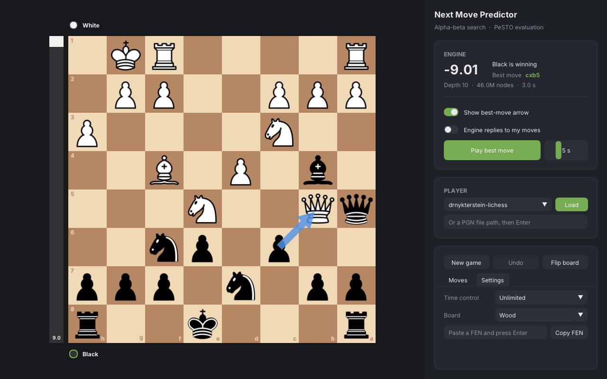

<div align="center">

# Chess Next Move Predictor

A desktop chess board with a built-in C++ engine that analyses every position and predicts the best next move,
and, from a player's past games, the move that **this player** would most likely play.

[](https://en.cppreference.com/w/cpp/17)
[](https://github.com/SFML/SFML)
[](https://github.com/ocornut/imgui)
[](https://github.com/Disservin/chess-library)


</div>

## Features

**Board**
- Drag-and-drop or click-to-move, with legal-move dots, last-move and check highlights
- Promotion picker, castling, en passant and all draw rules (stalemate, repetition, 50 moves, insufficient material)
- Flip the board, undo moves and pick a board theme (Green, Wood, Blue, Slate)
- Optional chess clocks (1 to 30 minutes)
- Paste a FEN to analyse any position, or copy the current one

**Engine**
- Analyses every new position in the background, so the window never freezes
- Live evaluation bar, score, search depth and a best-move arrow
- **Play best move** lets the engine move for the side to play (1 to 15 s think time, or stop early with *move now*)
- Optional auto-reply, so you can play a full game against the engine

**Player prediction**
- Download any player's games from Lichess or Chess.com with one command
- Load them in the app to see what that player chose in the current position: their top moves, how often and how they scored, with an orange arrow on the board
- Works for both colours and through transpositions; filter by bullet, blitz, rapid or classical
- Click a predicted move to play it, for example to walk through an opponent's repertoire before a game

<p align="center">
  
</p>

<p align="center">
  
</p>

## Building

You need a C++17 compiler and CMake 3.16+. SFML 3, Dear ImGui, ImGui-SFML and chess.hpp are git submodules.

```bash
git clone --recursive https://github.com/anurag67-droid/chess-next-move-predictor.git
cd chess-next-move-predictor
cmake -S . -B build
cmake --build build -j
./build/ChessNextMovePredictor
```

If you already cloned without `--recursive`, run `git submodule update --init` first.

If SFML 3 is installed on your system, CMake uses it. Otherwise it builds the bundled copy, which on Linux needs a few development packages:

```bash
sudo apt install libx11-dev libxrandr-dev libxcursor-dev libxi-dev libudev-dev \
                 libgl1-mesa-dev libfreetype-dev libharfbuzz-dev
```

Building also produces `player-book`, a command-line tool (see below), and a test suite you can run with `ctest --test-dir build`.

## Predicting a specific player

### 1. Download their games

`tools/fetch_games.py` needs only Python 3.9+ and saves the games to `players/<user>-<site>.pgn`, where the app looks for them:

```bash
python3 tools/fetch_games.py lichess DrNykterstein --max 3000
```

```bash
python3 tools/fetch_games.py chesscom hikaru --speed blitz,rapid --since 2025-01-01
```

| Option | Meaning |
|--------|---------|
| `--max N` | Keep the newest N games |
| `--speed LIST` | Only `bullet`, `blitz`, `rapid`, `classical`, `correspondence` games |
| `--since` / `--until DATE` | Date range, `YYYY-MM-DD` |
| `--rated-only` | Skip casual games (Lichess) |
| `--token TOKEN` | A Lichess API token, for faster downloads (or set `LICHESS_TOKEN`) |
| `--out FILE` | Save somewhere else |

Variants such as Chess960 are skipped. Lichess sends about 20 games per second without a token, so a few thousand games take a few minutes.

### 2. Load them in the app

In the **Player** card, pick the file and press **Load**, or paste the path to any PGN file. The app finds the player's name on its own: it is the name that appears in the most games. From then on, for every position the card lists the moves the player chose there, and the orange arrow shows the most frequent one. When the orange and blue arrows point the same way, the player's usual move is also the engine's choice.

A position is looked up by its Zobrist hash, so it is found however the player reached it, and only games where it was the player's turn count.

### 3. Measure how predictable they are

`player-book` prints a player's repertoire and tests the book honestly: it is built from the oldest games and tested on the newest 10%, so no game ever helps predict itself or an older game.

```bash
./build/player-book players/drnykterstein-lichess.pgn
./build/player-book players/drnykterstein-lichess.pgn --speed blitz --test-fraction 0.2
./build/player-book players/drnykterstein-lichess.pgn --fen "rnbqkbnr/pppppppp/8/8/4P3/8/PPPP1PPP/RNBQKBNR b KQkq - 0 1"
```

Result for 3,000 Lichess games of DrNykterstein (book from the oldest 2,700, tested on the newest 300):

```text
               positions   in book     top-1     top-3  top-1 in book
  Moves 1-10        2996     46.0%     27.2%     37.2%          59.0%
  Moves 11-25       4232      0.4%      0.3%      0.3%          61.1%
  Moves 26+         5504      0.0%      0.0%      0.0%           0.0%
  All moves        12732     11.0%      6.5%      8.9%          59.1%
```

*In book* is how often the player had already reached the position in an older game. *Top-1* is how often the book's most frequent move was the move they played. When the book knows a position it is right about 60% of the time, but after the opening almost every position is new. Predicting those is the job of the model in the next steps.

### Roadmap

1. **Per-player opening book** (done): download games, look up past choices, measure.
2. **Human-like fallback**: a general model of human play at the player's rating (Maia) for positions the book has never seen.
3. **Personal model**: fine-tune that model on the player's games and check that it beats step 2 on the same held-out games.
4. **In the app**: run the model with ONNX Runtime and draw its prediction for every position.

## How the engine works

The engine (`src/engine/`) is a classical alpha-beta searcher:

| Technique | What it does |
|-----------|--------------|
| Iterative deepening | Searches depth 1, 2, 3, ... until time runs out, keeping the best move from the deepest finished search. |
| Negamax with alpha-beta pruning | Skips branches that cannot change the result. |
| Transposition table | A lock-free hash table (Zobrist keys) that remembers positions already searched. |
| Move ordering | Tries the remembered best move first, then captures by MVV-LVA (most valuable victim, least valuable attacker). |
| Null-move pruning and check extensions | Cuts hopeless lines early and looks deeper when a king is in check. |
| Quiescence search | Plays out captures at the end of the search, so it never stops in the middle of an exchange. |
| Lazy SMP | Searches on every CPU core, with all threads sharing the transposition table. |
| PeSTO evaluation | Tapered middlegame/endgame piece-square tables, plus pawn structure, bishop pair, rook files and king shelter. |

## Project layout

```text
include/, src/
├── core/     game.*            game state, move history (SAN), FEN loading, game-over rules
├── engine/   search.*          iterative deepening alpha-beta search
│             evaluation.*      PeSTO static evaluation
├── predictor/ player_book.*    a player's past moves by position, speed filter, held-out evaluation
├── cli/      player_book_main  the player-book command-line tool
└── gui/      application.*     window, input handling and game flow
              panel.cpp         side panel, player bars, promotion picker
              player_worker.*   loads a player's games on a background thread
              board_renderer.*  board, pieces, arrows and evaluation bar (SFML)
              engine_worker.*   runs the engine on a background thread
              widgets.*, format.*, theme.hpp   UI helpers, text formatting, colours
tools/        fetch_games.py: downloads a player's games from Lichess or Chess.com
tests/        player book tests and a small sample PGN
players/      downloaded games (not committed)
assets/       piece sprites and the Inter font
third_party/  SFML, Dear ImGui, ImGui-SFML, chess.hpp (submodules)
```

## Limitations

- The engine has no opening book or endgame tablebases.
- Player prediction only knows positions the player has had before; for anything else the card says so (see the roadmap).
- The evaluation is hand-written and simple, so the engine is far weaker than engines like Stockfish.
- Move ordering has no killer-move or history heuristics yet, so it searches fewer plies than stronger engines.
