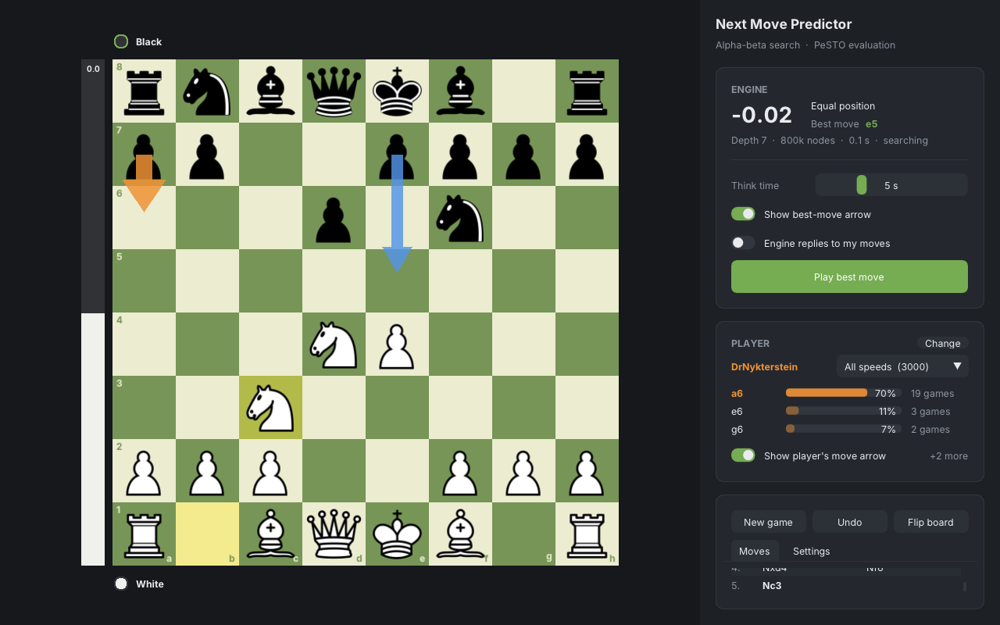
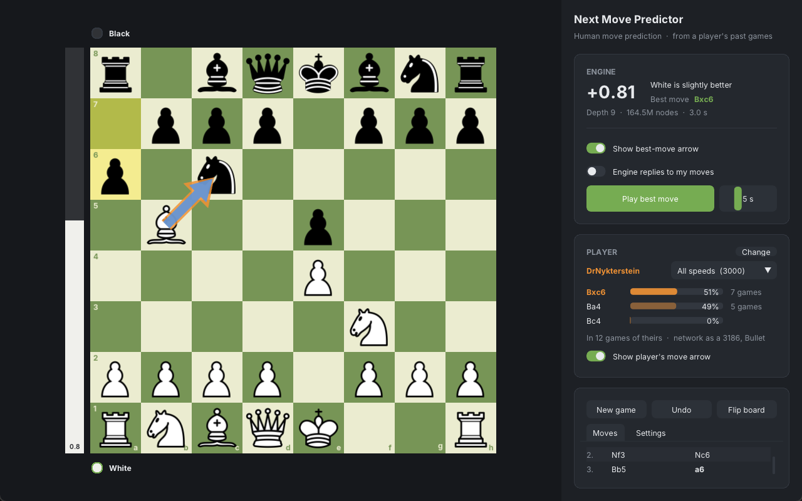

<div align="center">

# Chess Next Move Predictor

Predicts the move **a specific human player** will make next: not the best move, but *their* move.
It learns from the player's own past games and from a neural network, written from scratch in PyTorch
and trained on millions of Lichess positions, that plays like a human of any rating.

[](ml/)
[](https://pytorch.org)
[](https://database.lichess.org)
[](src/)



</div>

## What it does

Give it a player's username. It downloads their games from Lichess or Chess.com, and for any
position it answers: *what will this player play here, and how likely is each move?*

On each player's newest 10% of games, which it never saw, it predicts the exact move played
**49–56% of the time**, and the move is in its top 3 **74–84%** of the time:

| Player | Rating | Positions tested | Opening book alone | General network + book | Personal network + book | Top-3 |
|--------|-------:|-----------------:|-------------------:|-----------------------:|------------------------:|------:|
| affections (Lichess) | 1661 | 8,954 | 9.8% | 45.8% | **48.9%** | 73.7% |
| Shakiro (Lichess) | 1782 | 11,825 | 10.0% | 54.0% | **56.4%** | 83.7% |
| DrNykterstein (Lichess) | 3186 | 12,732 | 6.5% | 52.9% | **53.9%** | 82.8% |

*General network: 3.4M parameters, trained on 1M Lichess games (3½ hours on an RTX 4060 laptop GPU).
Personal network: the same network fine-tuned for two minutes on the player's 2,430 older games. It
beats the general one for all three players, by 1 to 3 points, in the opening, middlegame and endgame alike.*

## How it works

```text
 player's games ──► opening book ─────────────────────┐
 (Lichess / Chess.com)  their past choices by position │
                                                       ├──► probability of every legal move
 Lichess database ──► MoveNet (PyTorch) ───────────────┘
 1M games, 66M positions   position + both ratings + time control + clock
```

**1. Per-player opening book.** Every position the player has faced, indexed by its Zobrist hash so
transpositions are found, with what they played and how they scored. It is right about 60% of the
time when it knows the position, but after move 10 it almost never does: every game soon reaches a
position the player has not seen.

**2. MoveNet, a human move model.** A residual CNN that reads the board and predicts a probability
for each of 1858 possible moves. Unlike an engine, it is trained to imitate people, not to win, and
it is told who is playing: the mover's rating, the opponent's rating, the time control and the clock
are embedded and modulate every residual block (FiLM). So it can answer "what does a 1200 play in
blitz with 10 seconds left?" differently from "what does a 2500 play in classical?". A second head
predicts win/draw/loss.

**3. Combining them.** The book's counts and the network's probabilities are mixed as a Bayesian
prior: `p(move) = (times played + α · p_network) / (games in position + α)`. Where the player has a
habit, the book wins; everywhere else, the network fills the gap.

**4. Honest evaluation.** Everything is learned from a player's older games and tested on their
newest ones, so no game ever helps predict itself or an earlier game, and none of the test players'
games are in the network's training data.

Details, training commands and design notes: [ml/README.md](ml/README.md).

## Quick start

```bash
cd ml
python -m venv .venv && source .venv/bin/activate     # Windows: py -m venv .venv; .venv\Scripts\activate
pip install torch --index-url https://download.pytorch.org/whl/cu128   # or /whl/cpu
pip install -r requirements.txt

python ../tools/fetch_games.py lichess DrNykterstein --max 3000
python -m chessml.evaluate ../players/drnykterstein-lichess.pgn --model models/medium.pt
python -m chessml.predict --model models/medium.pt --elo 1500
```

`tools/fetch_games.py` needs only Python and saves games to `players/<user>-<site>.pgn`:

| Option | Meaning |
|--------|---------|
| `--max N` | Keep the newest N games |
| `--speed LIST` | Only `bullet`, `blitz`, `rapid`, `classical`, `correspondence` games |
| `--since` / `--until DATE` | Date range, `YYYY-MM-DD` |
| `--rated-only` | Skip casual games (Lichess) |
| `--token TOKEN` | A Lichess API token, for faster downloads (or set `LICHESS_TOKEN`) |

## Desktop app

A C++ board for exploring what a player would play. Load their games in the **Player** card, and for
every position it lists their most likely moves, with an orange arrow for the first. Where they have
a habit, it shows how often they chose each move and how they scored; where they have never been, the
network predicts for a player of their rating and usual time control. Click a predicted move to play
it, for example to walk through an opponent's repertoire before a game. It works for both colours and
through transpositions, and filters by bullet, blitz, rapid or classical. Without a player loaded, a
rating slider shows what anyone of that rating would play.

The app runs MoveNet itself, in plain C++ (`src/predictor/move_net.cpp`, no PyTorch or ONNX
runtime): 7 ms per position on a laptop CPU, with the same probabilities as PyTorch to within 10⁻⁶,
which `ctest` checks.

<p align="center">
  
</p>

For contrast, a blue arrow shows the objectively best move, from the search engine of my separate
[chess-engine](https://github.com/anurag67-droid/chess-engine) project. When the two arrows
disagree, the player's habit and the best move part ways.

Building needs a C++17 compiler and CMake 3.16+ (SFML 3, Dear ImGui and chess.hpp are submodules):

```bash
git clone --recursive https://github.com/anurag67-droid/chess-next-move-predictor.git
cd chess-next-move-predictor
cmake -S . -B build
cmake --build build -j
./build/ChessNextMovePredictor
```

On Linux, building the bundled SFML needs
`libx11-dev libxrandr-dev libxcursor-dev libxi-dev libudev-dev libgl1-mesa-dev libfreetype-dev libharfbuzz-dev`.

The build also produces `player-book`, a command-line tool that prints a player's repertoire and
measures the book alone on their newest games (`./build/player-book players/drnykterstein-lichess.pgn`),
and a test suite (`ctest --test-dir build`).

## Roadmap

1. **Per-player opening book** (done).
2. **General human move model** (done): MoveNet, conditioned on rating, time control and clock;
   51.0% top-1 on held-out Lichess games.
3. **Personal model** (done): fine-tuning MoveNet on one player's games (`chessml.personal`) adds 1
   to 3 points of top-1 on their newest games. Next: how few games it needs.
4. **In the app** (done): the network, exported with `chessml.export`, runs in C++ and predicts every
   position, not only the ones in the player's book.
5. **Next**: personal networks in the app, and the moves that led to the position as input.

## Project layout

```text
ml/chessml/   the move-prediction pipeline (Python, PyTorch)
              prepare.py   Lichess database → 78-byte position records, on every CPU core
              model.py     MoveNet: residual CNN with FiLM conditioning, policy and win/draw/loss heads
              train.py     mixed-precision GPU training, checkpoints, validation, rating ablation
              personal.py  one player's older games → a fine-tuning set
              evaluate.py  book vs network vs both on a player's newest games
              export.py    a trained network → the file the app reads
              book.py      the per-player opening book
ml/models/    the trained networks: medium.pt (PyTorch) and medium.movenet (for the app)
tools/        fetch_games.py: downloads a player's games from Lichess or Chess.com
src/, include/
├── predictor/  move_net.*      MoveNet inference in plain C++, and the book + network combination
│               player_book.*   the opening book in C++ (same results as book.py), speed filter, evaluation
├── cli/        player-book     command-line repertoire and accuracy report
├── gui/        the desktop app: board, player card, arrows (SFML + Dear ImGui)
├── core/       game state, SAN history, FEN, draw rules
└── engine/     best-move search for the blue arrow (from chess-engine)
tests/        C++ book tests; ml/tests/ has the Python tests
```

## Limitations

- The network uses the ratings, but modestly: setting everyone to 1500 costs the medium model 0.7
  points of top-1 (the small model: 0.1). Most of what a move reveals about the player is in the position itself.
- It sees only the current position, not the moves that led to it, so it cannot pick up a
  player's plans across moves.
- The app uses the general network, told the player's rating; personal networks work in Python
  but are not in the app yet.
